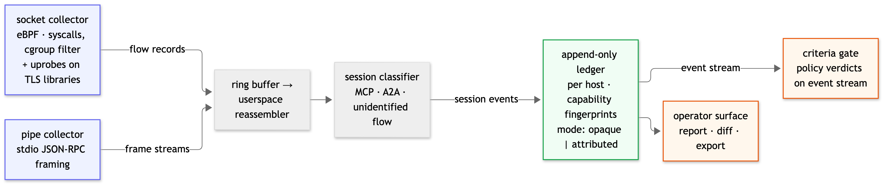
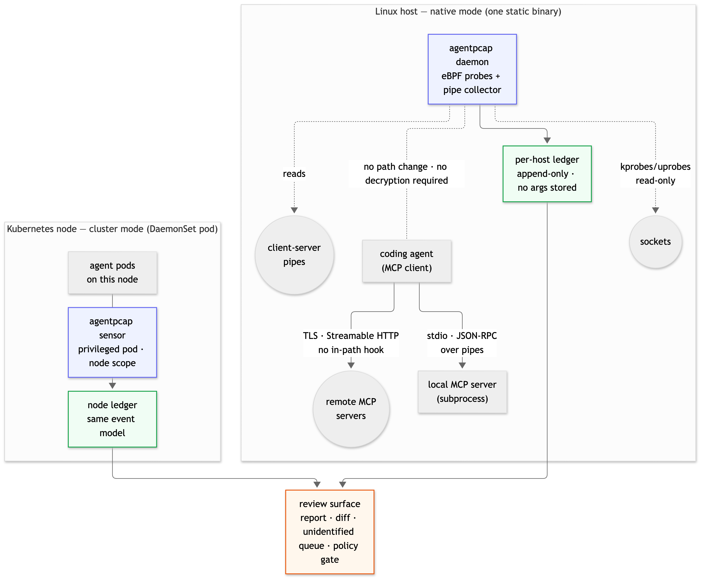

# Agentpcap: reading agent tool calls at the socket boundary

<strong>Shaineel Singh</strong> (email: shain.singh@owasp.org)

agentpcap research note · agent security research · Melbourne

Revision 0.4 — 21 November 2026 · github.com/shsingh/agentpcap

<strong>Abstract.</strong> Agent fleets reach their tools through the Model Context Protocol (MCP), and each tool call is a network event carried as encrypted traffic to endpoints the change process did not ticket. We survey the tooling an operator can use to see this traffic, across four classes: in-path gateways, secure web gateways with protocol detection, endpoint and eBPF capture, and inventory scanning. Each class resolves part of the problem and leaves a structural residue: routed-only coverage, mandatory TLS decryption, per-host agent scoping, missing MCP session semantics, and no append-only record of tool flows. We state the residue as a six-item gap set and sketch agentpcap, a read-only instrument that taps agents at socket and pipe boundaries, reassembles MCP and agent-to-agent sessions, and appends every flow to a lossless, per-host ledger designed for capability-drift review, with a criteria gate on the event stream as its policy surface. The instrument ships as one self-contained static binary with two placement modes — a host-native daemon and a per-node Kubernetes DaemonSet — and borrows upstream capture libraries at build time, so comprehensive coverage is one install that complements, rather than requires, the gateway and endpoint systems already deployed. An evaluation plan defines the six measurements that decide whether the build is justified. The argument concludes for re-use of the proven capture mechanics and a deliberately narrow build: the flow ledger and the unidentified-flow pass.

<em>Keywords — </em>Model Context Protocol · network visibility · eBPF · agent security · shadow MCP · flow ledger

<!-- TOC_BLOCK_START -->
<!-- TOC_BLOCK_END -->

# 1. Introduction

Enterprises now run fleets of language-model agents, and those agents reach tools through the Model Context Protocol (MCP) and adjacent agent protocols [2]. Each tool call is a network event: a JSON-RPC message that carries a tool name, a set of arguments, and a response. The calls cross enterprise networks as ordinary encrypted HTTP to endpoints that the change-management system did not ticket [2][3]. Network operations teams, who have run taps, flow collectors, and intrusion detection on this same wire for decades, now face a traffic class their tooling does not name.

This note answers one question: does the surveyed tooling or the research literature already provide the wire-level instrument these teams need, or is there a buildable gap? We survey open-source and commercial systems across four classes: in-path gateways, network detection, endpoint and eBPF capture, and inventory scanning. We state the surviving gap as an explicit set, sketch a design that closes it, and give an evaluation plan. The concluding argument is narrow: much of agentpcap can be re-used from existing projects, and a small remainder deserves building because no current system produces it.

This note is written for the reason the survey makes concrete. The deployed base is no longer hypothetical: thousands of internet-facing MCP services appeared within weeks of measurement, tool-less and under-governed at documented rates, and every surveyed class answers the question it was built for — routing, decryption-side detection, agent-scoped host capture, scan-time inventory — and none of them produces the joined record [18][19][20]. The residue survives because it crosses the mechanism boundaries of the surveyed classes; Section 5.9 traces it property by property. The note carries the design in research-note form; the normative specification lives in the project repository together with the implementation, released as free and open-source software.

# 2. Background: agent tool calls on the wire

## 2.1 The MCP transport and message surface

MCP encodes its messages as JSON-RPC and defines two standard transports: stdio, where the client launches the server as a subprocess and exchanges newline-delimited JSON-RPC over its pipes, and Streamable HTTP, where the server exposes a single HTTPS endpoint that accepts POST and GET and may stream responses over Server-Sent Events (SSE) [1]. The protocol is stateful: an initialization exchange negotiates capabilities, the client discovers tools with `tools/list`, and invokes them with `tools/call`; servers may also emit messages asynchronously to the client [1][11]. Recent protocol revisions require an `MCP-Protocol-Version` header on HTTP requests after initialization, which makes the header a usable protocol signal on conforming clients [5].

## 2.2 Protocols beyond MCP

Agent-to-agent (A2A) and related protocols carry task handoffs between agents, also over JSON-RPC-shaped transports [11][24]. Empirically, agent endpoints are concentrated: a crawl of the deployed ecosystem put 75% of them behind three providers, so traffic to a small set of hosts carries most agent flow [21]. A useful instrument must treat MCP as the named case and the wider agent-traffic class as part of the same problem, because fleets mix all of it on one wire.

# 3. The operator problem: shadow MCP and unidentified agent flows

Two failure modes dominate the operator's view.

The first is shadow MCP: unregistered MCP servers wired into agents without review. Microsoft's 2026 guidance names this shadow IT for the AI era and starts its control set with visibility and a runtime gateway; its own formulation is that you cannot govern, patch, or revoke what you cannot see [2]. OWASP's MCP Top 10 carries the same failure as MCP09:2025, noting that these deployments bypass centralized authentication and monitoring, and recommends passive network sensors that identify MCP traffic patterns as part of discovery [3].

The second is unidentified agent flows: traffic that is agent-shaped but not yet attributed. The scale of unmanaged deployment is documented from the outside. An internet-wide census counted 12,520 internet-accessible MCP services on 8,758 IP addresses across 56 countries and 425 autonomous systems at the end of April 2026, and over 21,000 by early May; among them, 1,056 services exposed direct database query interfaces and 687 exposed system-control tools [18]. Measurement studies of live remote servers found 40.55% of 7,973 servers exposing tools with no authentication, systematic OAuth deployment flaws in every tested OAuth-enabled server, 9 CVEs from responsible disclosure [19], and churn: 41.6% of confirmed servers in a dynamic audit vanished within three days [20].

Research also shows the wire leaks agent behavior even when the payload is protected. A passive metadata observer can classify which task an agent interaction belongs to sixfold over chance from packet timing and graph shape alone, and can act on a workflow before it completes, which reframes the wire as a workflow-integrity surface, not only a privacy surface [21]. A single-session packet capture of an autonomous coding agent shows the same story from the defender's side: the loop's rhythm, tool call followed seconds later by a model API call, is visible in encrypted traffic, and it is the payload that is missing without decryption [16].

The two failure modes reduce to four questions the operator keeps asking, and no surveyed system answers all four. What agents run on my estate, and what can they reach? Who called which tool, with which declared capabilities, and when? What changed since the last review — the capability-drift question that static scanners answer only at scan time [27] — and finally, which flows on my wire are agent-shaped but unattributed? The first three are ledger questions and the fourth is the unidentified class; both failure modes of this section point to the same missing view, a per-host, per-flow ledger of tool traffic that survives all four questions. Existing systems answer fragments of it; Section 4 shows where.

# 4. Related systems

## 4.1 In-path gateways and secure web gateways

A growing class of systems sits between agents and their tools. agentgateway, donated to the Linux Foundation in 2025 and accepted as an Agentic AI Foundation project, is a Rust data plane that routes MCP and A2A natively alongside HTTP and gRPC, maintains long-lived sessions, and exports observability for MCP tool discovery and invocation, including `tools/list` and `tools/call` tracing [11]. Commercial gateways cover the same ground at enterprise scale. Netskope's Agentic Broker adds MCP visibility, an MCP catalog, and real-time policy controls with a dashboard of session volumes and active servers [7]. Palo Alto Networks' AI Gateway intercepts agentic traffic at its enforcement points [8], and industry surveys list several further platforms whose MCP coverage depends on traffic reaching the Zero Trust Exchange or equivalent [9][10]. In-path MCP proxies at the endpoint, such as the pipelock class of scanning proxies, wrap individual servers and inspect JSON-RPC in both directions [25].

Every in-path system has one structural property: it is in the path by configuration. Traffic routed through the gateway is governed; traffic that does not traverse it is invisible to it. Secure web gateways state this themselves: proxies cannot see local stdio calls, off-network traffic, or connections that never reach the enforcement point [5][10]. This is why the shadow case and the gateway case are coupled: the deployment class that most needs the instrument is the class most likely to bypass it.

## 4.2 Network detection: DPI and heuristics

Microsoft's Global Secure Access MCP logging uses deep packet inspection that identifies MCP by the protocol itself rather than a catalog entry, and can thereby surface previously unknown or private MCP servers; it records sessions and operations, captures the initialize response with the server's advertised capabilities, and correlates events with network traffic logs [4]. Its costs are stated as clearly: TLS inspection is required because MCP data rides in the encrypted payload, and local MCP servers on the device are invisible because their traffic has no network footprint [4].

Cloudflare Gateway adds a protocol detection heuristic that classifies inspected requests as MCP and exposes an `is_mcp` policy selector and an AI security dashboard [5][6]. Its design analysis is the most explicit account of the detection boundary: the `MCP-Protocol-Version` header is a strong positive signal whose absence proves nothing; legacy clients, custom transports, and early-session traffic can all be MCP without it; and everything requires TLS decryption on the inspection path [5]. In the traditional IDS ecosystem, operators have begun hand-crafting the same story: community detection recipes publish Suricata and Zeek rules that flag MCP candidates from transport headers, with method-level payload matching as the smoking gun only where decryption exists [17].

None of these systems escapes decryption. All of the network-detection class is bound to an inspection point that terminates or decrypts TLS, and none of them covers the stdio transport, which never touches the network [4][5][17].

## 4.3 Endpoint and eBPF capture

The closest open-source system to this design is AgentSight, an eBPF-based observability framework for agents [12]. Its boundary-tracing approach monitors from outside the application: uprobes on TLS library functions capture plaintext LLM traffic at the point of encryption, tracepoints and kprobes capture process lineage and system actions, and a correlation engine joins the two streams; it is framework-agnostic, needs no instrumentation, and reports under 3% overhead [12]. The project is released as open source [12]. Its scope, however, is the single host and the known agent: the eBPF filter targets agent processes and their descendants, and its own documentation notes per-runtime capture boundaries, including the case where the trace is empty because the browser, the stdio channel, or a stripped binary sits on the other side [12].

Generic eBPF observability platforms demonstrate the capture mechanics but not the semantics. Pixie traces application protocol messages by snooping network syscalls with kprobes and, for TLS, by deploying uprobes on the encryption library itself, capturing data before it is encrypted; its supported protocol table covers HTTP, HTTP/2, DNS, PostgreSQL, MySQL, Redis, Kafka, and kin but has no MCP row [13]. Cilium's Hubble gives identity-aware flow visibility to L7 metadata for cloud-native estates [14]. Both are the substrate a protocol-aware tap would build on; neither names sessions, tools, or capabilities.

Detection tooling that is neither in-path nor host-resident exists. AgentSniff ships a detector suite covering active MCP probing by protocol version, TLS fingerprint hints, DNS and port observation, and behavioral profiling of agent-shaped traffic bursts [15]. A packet-capture study of one agent session demonstrates what raw tapping finds and what it cannot: 19,795 packets over 143 seconds toward 59 unique addresses, all TLS 1.3, with the agentic loop legible in timing and fingerprints while all payload stayed hidden [16].

## 4.4 Inventory, scanning, and threat knowledge

A fourth class catalogues servers rather than traffic. Static scanners check MCP configuration and server metadata before reliance: community scanners detect tool poisoning, injection, and rug pulls [26][25], and the Microsoft agent governance toolkit's MCP scan CLI checks tool descriptions, schema abuse, cross-server impersonation, and rug-pull fingerprint drift [27]. External census work enumerates exposures from the internet side [18]. Threat-intelligence platforms build structured knowledge around the ecosystem [23]. This class answers "what did we know at scan time"; it does not answer "what crossed the wire at 14:02".

## 4.5 Academic work and the boundary

Academic studies map the terrain. A defense-placement taxonomy for MCP finds protection predominantly tool-centric with persistent gaps at the transport and host-orchestration layers [22], which is exactly the vantage agentpcap occupies. Comparative threat modeling across MCP, A2A, and related protocols quantifies the risk of missing identity binding for executable components [24]. The metadata adversary work defines what an unprotected communication graph leaks and sets the boundary condition any operator instrument must respect [21].

# 5. Gap set and build slots

From the survey, no current system delivers all of the following. Each gap is stated with its evidence and its build consequence.

- **G001 — Out-of-path coverage.** In-path gateways govern what routes through them and, by construction, cannot see what bypasses them [5][7][11]. *Build consequence*: the instrument must be a tap, read-only and out-of-band, with no reliance on agents, SDKs, or routing configuration.
- **G002 — The undecrypted gap.** Network detection requires TLS inspection; its absence leaves only transport metadata, under which MCP remains unattributed except by weak signals [4][5][17]. *Build consequence*: operate in two modes — opaque (no decryption; protocol classification from transport and timing evidence) and attributed (decryption at an owned boundary) — with the mode recorded per event.
- **G003 — The stdio gap.** The stdio transport never touches the network, so every network-side system is blind to it; endpoint systems see it but are scoped per host and per agent process [4][12][17]. *Build consequence*: unified collectors for the socket class and the pipe class, emitting ledger events of the same shape.
- **G004 — Missing protocol semantics in generic L7 visibility.** Generic eBPF platforms parse a fixed protocol list without MCP/A2A sessions, so a tool call is only another HTTP transaction; nothing reconstructs sessions, capabilities, or tool invocations [13][14]. *Build consequence*: a semantic reassembly layer keyed on MCP session state, plus the equivalent A2A surface.
- **G005 — No operator flow ledger.** Visibility products expose dashboards at inspection points [4][7]. Scanners snapshot metadata at scan time [26][27]. No system produces the append-only, per-host, per-session record that joins discovered servers, advertised capabilities, and invocation events over time. That record is what incident review and capability-drift detection need [2][20]. *Build consequence*: the flow ledger is the core artefact — one lossless log in the append-only pattern that long-horizon agent work already favors [28].
- **G006 — Unidentified agent flows beyond MCP.** Active probers [15] and metadata classification research [21] each attack the unidentified class from one side; no operator instrument combines passive flow evidence with protocol probing to emit a triaged "unidentified agent flow" stream. *Build consequence*: classification from the ledger, not a separate product.

These six gaps define the build slots. They also define the boundary: what agentpcap is not. It is not a gateway [11]. It is not a scanner [26][27]. It is not a metadata-minimization transport for agents [21]. It is not an internet-wide census [18]. It is the operator's instrument for the flows the other classes do not cover.

**5.9 Why the residue survives.** The surviving residue is structural, not a lapse of engineering effort; each surveyed class carries a mechanism boundary it cannot cross. The gateway class observes traffic at a routing position; its coverage definitionally ends where routing ends, so the bypass flows sit outside its mechanism [5][7]. The network-detection class is bound to its decryption infrastructure [4][5], and the stdio transport leaves no network trace at all, so no network-resident mechanism can reach it under any configuration [1][4]. The endpoint-eBPF class scopes its probes to the agent processes it knows; its subject is application telemetry for the known fleet, not protocol sessions for all traffic on the host [12][13]. The scanner class samples metadata at scan time by construction [26][27]; a continuously appended ledger is not its sampling model. The unidentified class has no instrument home: the metadata work is research [21], and the probers are point tools [15]. What survives every class is the same object — a lossless, order-checked file no surveyed system produces — and that agrees with the ledger-first pattern of long-horizon agent memory work, where the append-only record outlives every system built to read it [28]. The residue has no owner among the surveyed classes; that is the build slot.

# 6. Design sketch

The design is a four-layer capture pipeline — tap points, semantic reassembly, flow ledger, gate handoff — plus a deployment model, a coexistence boundary, and an operator surface (6.5 to 6.8). Figure 1 shows the data path. Every layer is a re-use candidate first and a build slot second (Section 8 argues the split).

*Figure 1. The agentpcap data path. Two collectors feed one reassembler; classified session events append to the per-host ledger; the same event stream feeds the policy gate and the operator surface.*

**6.1 Tap points.** Three collectors, one event model, all read-only. First, a socket-level collector on Linux production estates: eBPF programs observe send and receive paths at the socket boundary, filtered by cgroup and process lineage in the AgentSight manner [12], writing flow records keyed by host, process, and five-tuple. Second, a TLS-boundary collector: uprobes on the encryption library capture plaintext before encryption where attribution is wanted, exactly as Pixie and AgentSight demonstrate for HTTP-class protocols [12][13]; this feeds the attributed mode. Third, a pipe collector for the stdio transport: tracing of reads and writes on the client–server pipes, closing the gap every network tool leaves open [1][4][5]. DNS, SNI, and existing flow metadata from the estate (Hubble-class [14]) feed attribution in opaque mode.

**6.2 Semantic reassembly.** A userspace state machine turns frame streams into session events. For MCP: initialization negotiation, tool discovery, tool invocation, and server-initiated messages, keyed by session identifiers on Streamable HTTP [1][11]; protocol-version headers recorded as evidence per session [5]. For A2A: task handoff events on the equivalent transport [11][24]. Sessions with no recognizable protocol become first-class events themselves — the unidentified class — carrying transport features, burst and loop patterns, and peer identity for later probing [15][16][21].

**6.3 The flow ledger.** Events append to a plain-text, order-checked ledger: timestamp, host, process lineage, transport, mode (opaque or attributed), protocol verdict, method, tool name, capability fingerprint from initialize responses, and peer. Arguments and payloads are not stored by default; capability fingerprints and tool names are, so that capability drift between sessions — the rug-pull pattern that static scanners check at scan time [27] — becomes a query on the ledger. The record schema is fixed and versioned: it is the project's interface contract, and both deployment topologies (6.5) emit it identically. Storage is the append-only pattern with a regex read sidecar [28]: no index to rebuild, provenance by line.

**6.4 Gate handoff.** The ledger's event stream is exactly what a criteria gate wants as input. The VFM verifier scores large sets of natural-language governance criteria against agent output in under 2 seconds on one accelerator, returning per-criterion satisfied, violated, and inapplicable verdicts [29]. A policy pass over ledger events ("no tool calls to unregistered servers", "no system-control invocation from unregistered servers" [18]) re-uses that machinery instead of inventing a new rule language.

**6.5 Deployment: one binary, two placement modes.** The build output is a single static binary, not a platform and not a fleet of sidecars, and it answers the placement question directly: agentpcap runs natively on hosts, natively under Kubernetes, and nowhere else needs installing for either. Figure 2 shows both modes.

*Figure 2. agentpcap placement modes. Left: one static binary as a host daemon, tapping pipes and sockets read-only, appending to a per-host ledger. Right: the same binary per node as a DaemonSet pod, tapping the node's agent pods. Both faces emit the same event schema to the review surface.*

In host-native mode, the same binary runs as a service under the host's init (systemd or launchd) with a bounded capability set for eBPF (BPF and performance-monitoring capabilities plus write access to the ledger path, documented at repo time) and keeps a per-host ledger at a versioned path, with optional onward export to the estate's existing collection. In cluster-native mode, the identical binary ships in a container image placed per node as a DaemonSet — the per-node placement eBPF observability already uses [13][14] — with node-scoped visibility of the agent pods on that node and a node ledger in the same format. The two modes share one event schema and one ledger format: a consumer cannot tell from a record whether it came from a laptop or a node, and cluster-wide review is the aggregation of node ledgers, not a second system. Platform truth is stated plainly: the eBPF collectors are Linux-only, the DaemonSet is the Linux-cluster face, and the review subcommands (6.7) run anywhere the binary runs, including operator workstations outside the captured estate.

**6.6 Coexistence: borrow code, not installs.** The comprehensive view does not require stacking products, and nothing else becomes a prerequisite. In the default standalone mode, agentpcap is the only new install on the host or node: the capture mechanics ride inside the binary as linked libraries at build time — aya for the Rust eBPF probe and userspace split [30], and the released probe programs of AgentSight as re-use or reference implementations where licensing permits [12]; no AgentSight deployment, no gateway, and no second sensor is required. In the federated mode, where the operator already runs an in-path gateway [11][7] or a host observer [12], agentpcap consumes their exports as corroborating evidence into the same ledger and confines itself to what they structurally do not produce — the bypass flows (G001), the undecrypted class (G002), stdio (G003), the unidentified stream (G006) — with flow-level deduplication keyed on five-tuple and session identifiers so no event records twice. In the build-time reuse mode, other projects embed the pieces: the tap libraries as dependencies, the same Apache-2.0 terms that license aya [30] and agentgateway [11] making the protocol session layer a re-use candidate rather than a protocol question. The one-line answer to the operator's stack question: one tap, installed once, consuming whatever the estate already runs, and replacing nothing it runs.

**6.7 Operator surface and daily use.** The binary carries four subcommands. `record` is the default service face: capture running, ledger appending. `report` renders the sessions view — per peer, per server: tools discovered, capability fingerprints, invocation counts, transport and mode — answering "who called what with which capabilities" directly from the ledger. `diff` compares two report sets and emits capability drift: new tools, changed descriptions, removed tools, re-scoped servers — the rug-pull review at drift time rather than scan time [27]. `export` streams ledger events to the gate (6.4) or to estate collection. Four daily flows follow: the incident query re-derives "what crossed the wire at 14:02" as a ledger read (Section 4.4); the quarterly capability-drift review is `report` plus `diff` per server; the shadow-discovery triage queue is the unidentified-class stream from `record`, each event carrying its probing leads [15][21]; and the policy check is the event stream against the operator's declared criteria [29].

**6.8 Implementation language.** The implementation is Rust. The choice rests on the shape of the instrument: the tap is an always-on, host-resident sensor whose write path must be predictable (a ledger writer without garbage-collection pauses), whose kernel leg runs as eBPF bytecode that aya keeps in the same toolchain and language as the userspace [30], and whose distribution form is a static binary (6.5). Memory safety at the systems boundary is the instrument's own security property: a read-only tap that becomes writable memory on the host would betray its threat model. Rust gives that property with a single toolchain across both collector layers. The project is released as free and open-source software under the MIT licence; its specification and implementation live in the public repository.

# 7. Evaluation plan

The evaluation plan doubles as the measurement plan for an operator-facing conference presentation; it is deliberately built on numbers the existing literature already publishes as comparisons.

- **M1 — Shadow discovery.** Seed a lab fleet with N known MCP clients and servers plus shadow deployments; measure discovery recall of agentpcap against the header-heuristic class [5] and against active probing [15] on the same live traffic.
- **M2 — Overhead.** Measure tap overhead against AgentSight's published sub-3% with the equivalent collectors [12].
- **M3 — Transport coverage.** A coverage matrix over stdio, Streamable HTTP, legacy HTTP+SSE, custom transports, and A2A. The survey says today's systems each leave at least one of these uncovered [4][5][10].
- **M4 — Ledger fidelity.** Capture capability drift between sessions and confirm the ledger surfaces it without decryption; static scanners detect the same pattern only at scan time [27].
- **M5 — Unidentified-flow triage.** Score the unidentified class against the metadata-classification baseline [21] and the prober baseline [15]: precision of the "agent-shaped, unattributed" label.
- **M6 — Gate handoff.** Ledger-to-verdict latency against the 2-second criteria-scoring budget [29] on representative event bursts.

Passing M1 with M3's full matrix, at M2's cost, is the demo result that justifies the project.

# 8. Build or reuse: the argument

Re-use first. The socket-level and TLS-boundary capture mechanics are open source and proven: AgentSight's eBPF probes and correlation engine [12], Pixie's uprobe-on-TLS-library technique [13], and Cilium/Hubble flow layers [14] are candidates for direct re-use or contribution. Owned in-path traffic is best left to in-path tooling: the agentgateway class [11] does protocol-aware sessions, tracing, and policy today, and the commercial gateways [4][7] cover the same ground at enterprise scale. A tap should not duplicate a gateway. Configuration and metadata scanning is likewise solved [18][26][27].

Build the remainder, and the remainder is specific: the pipe collector and the unified event model (G003), the reassembly layer for sessions that generic L7 tools do not parse (G004), the append-only flow ledger with capability fingerprints (G005), and the identification pass for unidentified flows (G006, G001, G002). Nothing found in the survey produces that whole; each partial provider misses a different half, which is itself the summary of Sections 4 and 5. The build is justified as infrastructure, as method: a small, read-only tap whose output every existing control — gateway, scanner, gate — can consume.

# 9. Discussion and ethics

**Limits.** TLS 1.3, QUIC, and Encrypted ClientHello constrict opaque-mode evidence to timing, size, and endpoint metadata [16]; the design answers with the attributed mode at owned boundaries rather than promising omniscience. Kernel coverage follows eBPF's platform constraints; the pipe collector runs where eBPF does not. The tap is deliberately not an interception point and changes no path.

**Privacy and dual use.** The instrument that classifies workflows from metadata can, in other hands, front-run them; the research literature puts that boundary precisely [21]. The response is data minimization as product behavior: opaque mode by default, arguments not stored, access to the ledger logged and itself append-only. The operator vantage assumed throughout is the lawful one — an organization tapping its own estate — and the adversary model is the shadow deployment and its supply chain [2][3], not other tenants on a shared wire.

**Ethics statements.** The work targets defender instrumentation on the operator's own estate. Evaluation uses lab fleets and synthesized shadow deployments, never third-party estate traffic. Public internet-exposure numbers are cited from the published censuses [18][19][20] and are not reproduced independently. The ledger design stores no tool arguments and no user content by default, and the gate criteria in 6.4 are the operator's own declared policies [29].

# 10. Conclusion

The surveyed systems answer most of this question, one class at a time: gateways for routed traffic, secure web gateways with protocol detection under decryption, eBPF frameworks for agent-scoped host capture, scanners for configs, and censuses for the internet side. The residue — the flows that bypass the gateways by construction, the transport that never touches a network, the protocol that generic observability does not parse, and the absence of one append-only ledger of who called what with which capabilities — is small, specific, and currently unowned. Agentpcap, as sketched, is mostly re-assembled from proven open-source parts into one static binary that runs host-native or as a per-node DaemonSet, with the operator flow ledger and the unidentified-flow pass as its genuinely new halves. The project is released as free and open-source software; the normative specification and the implementation live in the public repository. The next step is the evaluation fleet of Section 7.

# 11. References

[1] https://modelcontextprotocol.io/specification/2025-11-25/basic/transports — Model Context Protocol specification, revision 2025-11-25: Transports

[2] https://techcommunity.microsoft.com/blog/microsoft-security-blog/the-state-of-mcp-security-in-2026/4531327 — The state of MCP security in 2026 (Microsoft Security Blog)

[3] https://owasp.github.io/www-project-mcp-top-10/2025/MCP09-2025%E2%80%93Shadow-MCP-Servers — OWASP MCP Top 10 - MCP09:2025 Shadow MCP Servers

[4] https://learn.microsoft.com/en-us/entra/global-secure-access/how-to-view-model-context-protocol-logging — How to view Model Context Protocol (MCP) traffic logs in Global Secure Access (Preview)

[5] https://blog.cloudflare.com/mcp-security-updates — How Cloudflare detects MCP traffic and helps secure it

[6] https://developers.cloudflare.com/changelog/post/2026-08-12-mcp-detection-and-dashboard — MCP protocol detection and AI Security dashboard (Cloudflare changelog)

[7] https://docs.netskope.com/en/agentic-broker — Netskope Agentic Broker documentation

[8] https://www.paloaltonetworks.com/ai-security/ai-gateway — Prisma AIRS AI Gateway (Palo Alto Networks)

[9] https://witness.ai/blog/palo-alto-prisma-alternatives — 6 best Palo Alto Prisma alternatives for AI security (2026)

[10] https://www.arcade.dev/blog/dlp-solutions-ai-agents — 9 best AI agent DLP solutions for secure LLM tool calls (2026)

[11] https://docs.solo.io/agentgateway/standalone/latest/documentation/about/introduction — agentgateway introduction (Linux Foundation / AAIF)

[12] https://arxiv.org/abs/2508.02736 — AgentSight: System-Level Observability for AI Agents Using eBPF

[13] https://docs.px.dev/about-pixie/pixie-ebpf — How Pixie uses eBPF

[14] https://github.com/cilium/hubble — Hubble: network and security observability for cloud native workloads

[15] https://docs.agentsniff.org/detectors — AgentSniff: detectors

[16] https://blazesecurity.substack.com/p/i-captured-what-an-ai-agent-looks — I captured what an AI agent looks like on the wire (Blaze Security)

[17] https://disinfectedmind.substack.com/p/tech-deep-dive-hunting-for-mcp-in — Hunting for MCP in the wild

[18] https://censys.com/blog/mcp-servers-on-the-internet — MCP servers on the internet (Censys)

[19] https://arxiv.org/abs/2605.22333 — A First Measurement Study on Authentication Security in Real-World Remote MCP Servers

[20] https://arxiv.org/abs/2608.00150 — Dynamic assessment of internet-facing MCP servers

[21] https://arxiv.org/abs/2606.07150 — From Privacy to Workflow Integrity: Communication-Graph Metadata in Autonomous Agent Interoperability

[22] https://arxiv.org/abs/2604.07551 — MCP-DPT: A Defense-Placement Taxonomy and Coverage Analysis for MCP Security

[23] https://arxiv.org/abs/2604.13849 — MCPThreatHive: Automated Threat Intelligence for MCP Ecosystems

[24] https://arxiv.org/abs/2602.11327 — Security Threat Modeling for Emerging AI-Agent Protocols: MCP, A2A, Agora, and ANP

[25] https://pipelab.org/blog/state-of-mcp-security-2026 — State of MCP Security 2026: Incidents, Attack Patterns, and Defense Coverage (PipeLab)

[26] https://mcpscanner.cloud — MCP Scanner: security scanner for MCP servers

[27] https://microsoft.github.io/agent-governance-toolkit/tutorials/27-mcp-scan-cli — MCP Scan CLI (Microsoft Agent Governance Toolkit)

[28] https://arxiv.org/abs/2611.25123 — Forget Freely, Grep Later: Lossless, Index-Free Memory for Long-Horizon LLM Agents

[29] https://arxiv.org/abs/2611.23074 — Runtime Verification of Multiple Natural Language Criteria for Agent Governance

[30] https://github.com/aya-rs/aya — aya: an eBPF library for the Rust programming language (Apache-2.0)
