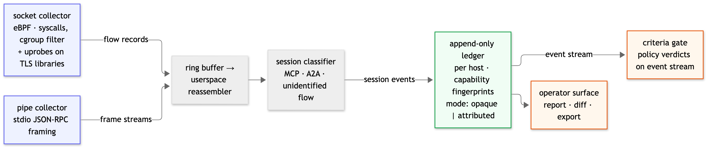
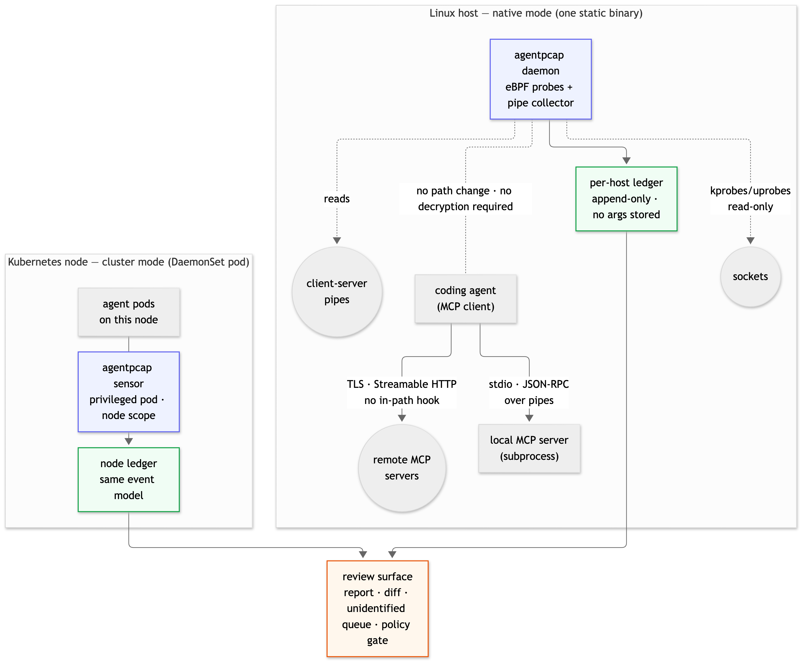

## Components

The instrument is one binary with six components: a socket collector
(eBPF, cgroup-filtered), a TLS-boundary collector (uprobes; runs by
default), a pipe collector for the stdio transport, the reassembler
that turns frames into session events, the ledger writer, and the
operator CLI (`record`, `report`, `diff`, `export`).

Capture is read-only: no interception, no termination, no path change.
Capture loss degrades the ledger; the path is never affected.

## Placement

One binary, two placement modes, one event schema.

- **Host-native:** a systemd or launchd service with a bounded eBPF
  capability set and a per-host ledger at a versioned path.
- **Cluster-native:** the identical binary per node as a Kubernetes
  DaemonSet; the node ledger carries the same schema; cluster review
  aggregates node ledgers.

## The flow ledger

JSON Lines, append-only, hash-chained (`prev` field), access-logged.
Tool messages ride the record: method, arguments and result.
Retention and redaction are operator settings; rotation preserves the
prefix; no index is built. Capability drift between sessions — the
rug-pull pattern scanners check once — becomes a query at drift time.

## Modes

Attributed mode is the default: uprobes on the host's own TLS libraries
capture plaintext before encryption, so the record carries the method,
the arguments and the result — with no TLS termination and no change to
any path. Opaque mode (metadata only) is the per-host opt-out. Every
event records the mode that produced it.

The full normative text is the
[specification](https://github.com/shsingh/agentpcap/blob/main/docs/spec.md).
